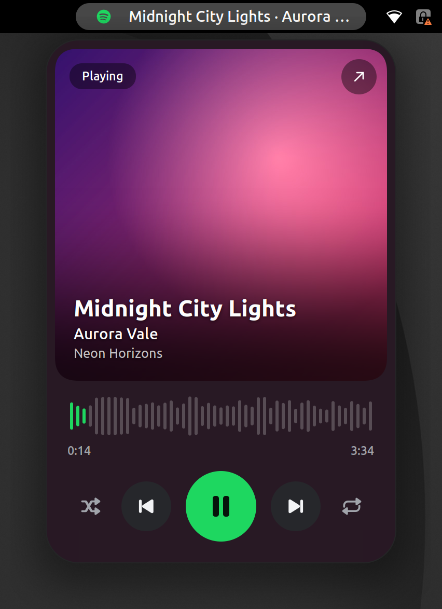
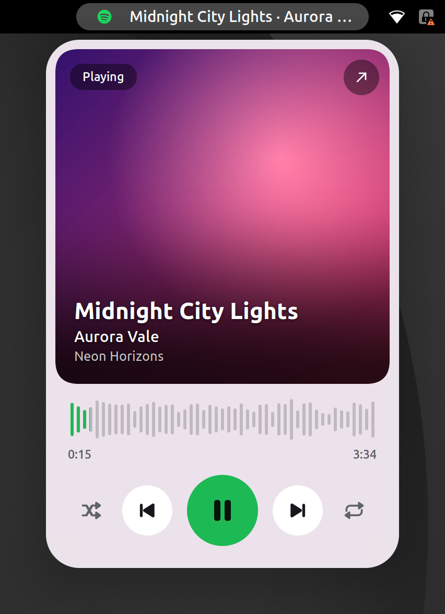
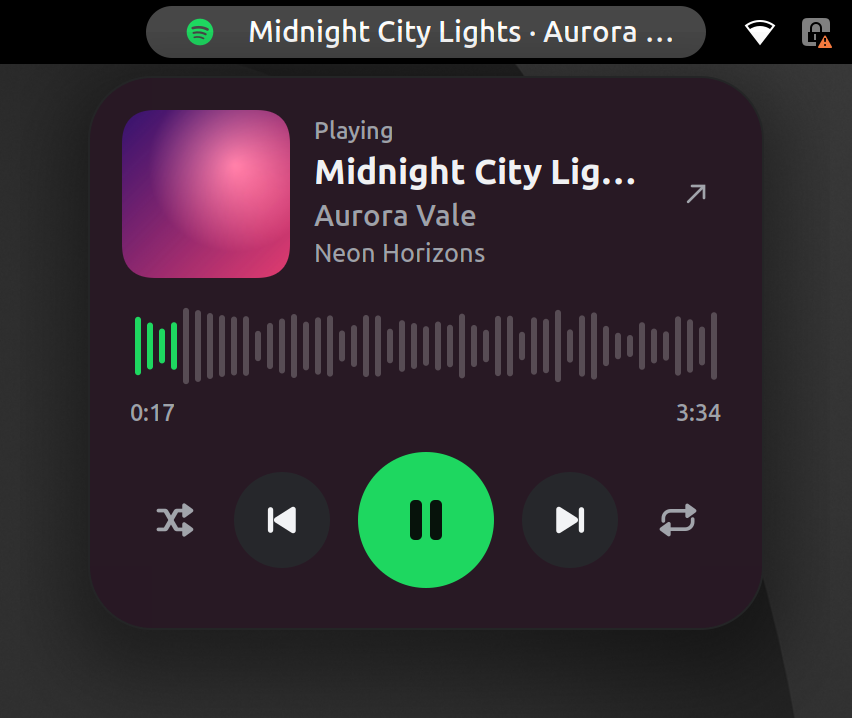
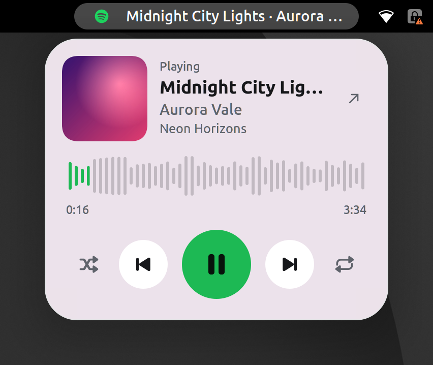
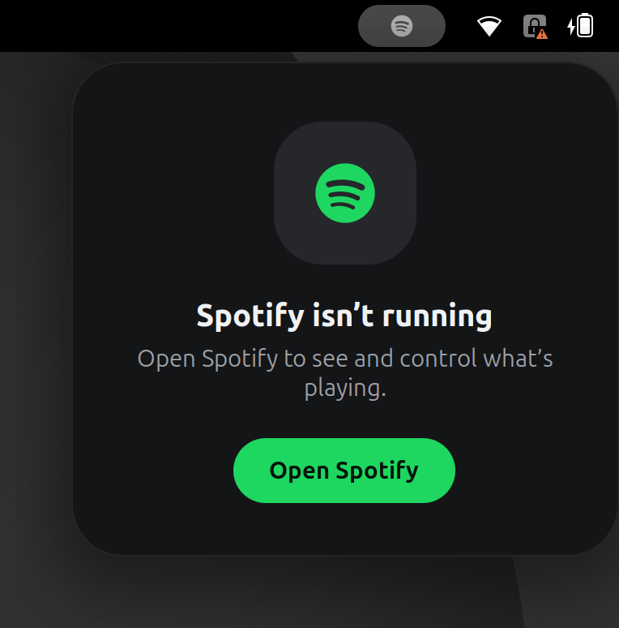
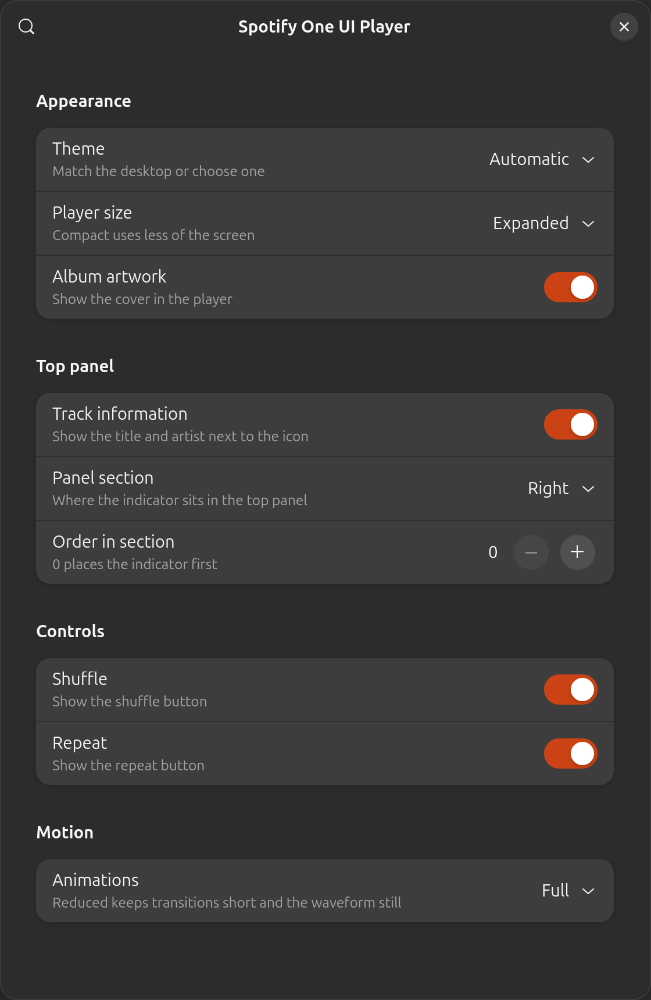

# Spotify One UI Player

A premium Spotify player for the GNOME top panel, inspired by the media player in
Samsung One UI 9. It is a native GNOME Shell extension that talks directly to the
Spotify desktop app, with no account linking and no API keys.

<p align="center">
  
  
</p>

> Screenshots come from the automated test run, so the track and the covers are
> generated test data rather than real Spotify content.

## Features

- **Artwork first.** Track details sit on top of a large album cover, with corners
  and a scrim rendered into the image itself so they stay crisp at any scale.
- **Waveform seek bar.** Click, drag, scroll or use the arrow keys to seek.
- **Full playback control.** Play and pause, next, previous, shuffle and repeat.
- **Album tinted surface.** The card picks up a soft tint from the current cover.
- **Dark and light themes.** Follows the desktop automatically, or pick one.
- **Compact layout.** Chosen in preferences, and used automatically on short screens.
- **Graceful states.** Clear screens for Spotify not running, not installed, or idle.
- **Honest controls.** If your Spotify client ignores a command such as shuffle, that
  button is hidden for the session instead of doing nothing.

<p align="center">
  
  
</p>

<p align="center">
  
</p>

## Requirements

- GNOME Shell 50. This is the only version tested, so it is the only one declared.
- The Spotify desktop app (snap, Flatpak or distribution package).

## Installation

```bash
git clone https://github.com/ammarqaisar11a55/Spotify-GNOME-Extension-Samsung-One-UI-9-Inspired.git
```

```bash
cd Spotify-GNOME-Extension-Samsung-One-UI-9-Inspired
```

```bash
make install
```

On Wayland, GNOME Shell only finds new extensions at login, so log out and back in.
Then turn it on:

```bash
gnome-extensions enable spotify-oneui@ammarqaisar11a55.github.io
```

To remove it:

```bash
make uninstall
```

## Preferences

Open them from the Extensions app, or run:

```bash
gnome-extensions prefs spotify-oneui@ammarqaisar11a55.github.io
```

<p align="center">
  
</p>

| Section | Setting | Options |
| --- | --- | --- |
| Appearance | Theme | Automatic, Dark, Light |
| Appearance | Player size | Expanded, Compact |
| Appearance | Album artwork | On, Off |
| Top panel | Track information | On, Off |
| Top panel | Panel section | Left, Center, Right |
| Top panel | Order in section | 0 to 32 |
| Controls | Shuffle, Repeat | On, Off for each |
| Motion | Animations | Full, Reduced, Off |

## How it works

The extension watches Spotify's MPRIS name on the session bus and reacts to its
signals, so it does no work while Spotify is closed. MPRIS does not signal playback
position, so position is interpolated locally and re-read every 5 seconds, only
while the popup is open and music is playing. Nothing animates while the popup is
closed.

MPRIS exposes no audio data, so the waveform's shape is decorative. It is derived
from the track id, which gives each song a stable silhouette, but it does not
represent the sound.

Album art is downloaded from the URL Spotify reports and cached in
`~/.cache/spotify-oneui/artwork`, capped at 120 images. That image request is the
only network traffic the extension makes.

```text
extension.js            Enable and disable, panel placement
prefs.js                Preferences window
stylesheet.css          All styling, see docs/DESIGN.md for the tokens
schemas/                Settings
icons/                  Original symbolic icons
src/
  spotifyClient.js      MPRIS over D-Bus, feature detection
  playbackClock.js      Position interpolation
  artwork.js            Download, cache, decode, round and tint
  spotifyApp.js         Finds the installed Spotify app
  motion.js             Animation preference
  themeController.js    Follows the desktop color scheme
  ui/                   Indicator, player view, seek bar, buttons, placeholder
tests/                  Headless test suite and mock player
docs/                   Design system and screenshots
```

## Testing

The test suite runs the packaged extension inside a disposable headless GNOME Shell,
on a private D-Bus with a throwaway home directory. Your desktop, your settings and
any running Spotify client are not touched. It drives the UI with a virtual pointer
and keyboard against a mock player that speaks real MPRIS.

```bash
make test
```

Screenshots are written to `dist/test-output`. Some display checks need a specific
virtual monitor:

```bash
TEST_MONITOR=1280x560 TEST_ONLY=testShortScreen bash tests/run-headless.sh
```

```bash
TEST_MONITOR=3840x2400 TEST_ONLY=testHiDpi bash tests/run-headless.sh
```

To check the extension beside another installed extension, list its uuid:

```bash
TEST_EXTRA_EXTENSIONS="other-extension@example.com" bash tests/run-headless.sh
```

To see what your own Spotify client supports, open Spotify with a track loaded and
run this from a normal terminal. It briefly toggles shuffle and repeat and seeks
10 seconds forward and back, restoring each afterwards.

```bash
bash tests/check-real-spotify.sh
```

## Disclaimer

This project is not affiliated with, endorsed by, or sponsored by Spotify or Samsung.
Spotify and One UI are trademarks of their respective owners. One UI is used as
design inspiration only, and no proprietary fonts, icons or other assets are included.
